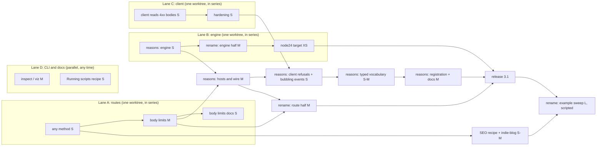

## What and Why

The plan for the next two minors and the major they lead to, with every decision made on 2026-11-22 folded in: what ships in each release, which work runs in parallel worktrees and which in series, and what was parked for lack of evidence. Each feature large enough to need one has its own spec; this file holds the order and the reasons for it.

(The filename says "through 3.3" from the first draft. The 3.3 "cached pages" release no longer exists; see Parked.)

| Release | Theme | What ships |
| --- | --- | --- |
| 3.0.x | patches | `stator dev` ignores `config.events`; a claims read always withdraws derived caching; the build-mismatch reload guard; the layout fingerprint; a fall-through page names its route |
| 3.1 | forms and the wire | refused-dispatch reasons over 4xx, client error-handling hardening, request body limits, `defineDataRoute`, the `reads` rename as aliases, the `node24` hash target |
| 3.2 | schemas | event payload schemas: bring your own Standard Schema validator, `warn` by default |
| any | rides the next release when merged | `stator inspect` / `stator viz`, the SEO recipe with `indie-blog`, the "Running scripts" recipe |
| 4.0 | schemas required | every `defineMachine` event has a schema; old `reads` names removed; `method` removed from `defineApiRoute`; 1 MiB default body limit; `zod` removed; root `media/` dir |

Specs:

- [`a-claims-read-always-withdraws-derived-caching`](./a-claims-read-always-withdraws-derived-caching.md) (patch)
- [`a-build-mismatch-reload-is-guarded-against-a-stale-cache`](./a-build-mismatch-reload-is-guarded-against-a-stale-cache.md) (patch)
- [`a-layout-fingerprint-reloads-a-page-whose-ids-no-longer-match`](./a-layout-fingerprint-reloads-a-page-whose-ids-no-longer-match.md) (patch)
- [`a-page-served-by-a-fall-through-names-its-route`](./a-page-served-by-a-fall-through-names-its-route.md) (patch; stacked on the fingerprint)
- [`refused-dispatch-reasons`](./refused-dispatch-reasons.md) (3.1; revised for 4xx)
- [`client-side-event-error-handling`](./client-side-event-error-handling.md) (3.1 hardening and bubbling events; the rest parked)
- [`request-body-size-limits-for-uploads-and-api-routes`](./request-body-size-limits-for-uploads-and-api-routes.md) (3.1)
- [`definedataroute-defines-a-data-route`](./definedataroute-defines-a-data-route.md) (3.1; replaces [`defineapiroute-takes-any-http-method`](./defineapiroute-takes-any-http-method.md), archived)
- [`the-reads-family-rename-ships-as-aliases-machines-on-routes-peers-on-machines`](./the-reads-family-rename-ships-as-aliases-machines-on-routes-peers-on-machines.md) (3.1)
- [`event-payload-schemas`](./event-payload-schemas.md) (3.2, cutover at 4.0; body being revised to its decision record)

Parked, each with a decision record saying why: [`presence-…`](./presence-a-read-over-live-connections-a-debounced-watch-and-the-crdt-boundary.md), [`per-visitor-content-on-a-cached-page-…`](./per-visitor-content-on-a-cached-page-late-routes-request-locals-and-the-load-time-sync.md), [`stator-exec-…`](./stator-exec-run-a-script-with-the-app-s-loader-and-config.md).

## Success Criteria

- Each release ships from `main` with every PR non-breaking; anything that could be breaking has a non-breaking shaping now and an entry in the 4.0 ledger below.
- No release resets sessions more than once, and each reset is stated in a changeset.
- Work in separate worktrees never edits the same region of a file at the same time; where two tracks must touch one file, this plan names which goes first.
- Every new primitive is exercised by an example before release: `registration` for refusal reasons and schemas.
- Nothing ships ahead of evidence. A feature whose motivation is a thought experiment or an unbuilt example is parked with a named trigger.

## Constraints

Three facts about the tree decide the order.

**1. Engine edits reset every session.** The engine hash covers every file under `src/engine/` except `engine/describe.ts`, plus a set of host files (`server/machine-hash.ts`, `ENGINE_CUT` and `ENGINE_HOST`). Any change to them discards every persisted snapshot in every app once on upgrade. So engine-touching work is batched per release:

- 3.1: refusal reasons (engine PR), the rename's engine half, the `node24` target. One reset.
- 3.2: event schemas. One reset.
- New formatters and helpers stay out of `engine/` unless they have to be there (the chart formatters go under `cli/`).

**2. A few files are shared by almost everything.** Tracks that touch them run in series, in this order:

| File | Order of edits |
| --- | --- |
| `server/routing.ts` (`DefineApiRouteConfig`, the route object literal) | any method → body limits → reasons (hosts) → rename (route half) → schemas (doors) |
| `server/http.ts` | cache-bug fixes (`deriveCacheControl`, the `/__sse` build check) → body limits (one early middleware) → reasons (`/__events` statuses, log level) → schemas (`/__events` validation, the hand-written envelope check) |
| `engine/types.ts`, `engine/define-machine.ts`, `engine/actor.ts` | reasons (engine) → rename (engine half) → schemas |
| `client/transport.ts`, `client/dispatch.ts`, `client/runtime.ts` | reload-loop guard → client reads 4xx bodies → hardening → reasons (client) with bubbling events |

Config plumbing (`src/config.ts`, `server/create-app.ts`, `server/dev.ts`, `server/dev-native.ts`, `cli/commands/start.ts`, `cli/commands/dev.ts`) is touched by body limits (`requests`) and schemas (`events.schemas`); the second to land rebases adjacent lines. `server/index.ts`, `tests/server-barrels.test.ts`, `reference/server.md` and `ROADMAP.md` are edited by every track; expect trivial conflicts.

**3. The example sweep is the last thing in 3.1.** The rename's third PR rewrites every example route, and `create-stator` fetches `examples/` from `main` while pinning the published version, so the sweep lands after 3.1 is on npm and before any new example work starts. It is regenerated by script, never rebased.

## Approach

### Now: patches

- **`stator dev` ignores `config.events`** (one line): `cli/commands/dev.ts` never passes `config.events` to `createDevApp`, so `events.gate` and `events.maxBytes` are ignored under `stator dev` (`start.ts` passes them). Ship it first so no feature branch carries it.
- **The two cache bugs**, both confirmed on 2026-11-22 with runnable tests (see Confirmed bugs below). They are patch-level and come before 3.1 in `server/http.ts` and `client/runtime.ts`. Fixes chosen 2026-11-22, each with its own spec: any claims read withdraws the derived header; the client guards the build-mismatch reload with a growing delay. Live pages stay cacheable.

### Confirmed bugs

Reproduced in an isolated worktree (`.claude/worktrees/agent-a2b1f92db79560741`, tests uncommitted under `packages/stator/tests/repro-*.test.ts`, `tests/fixtures/cdn-repro/` and `browser-tests/repro-stale-reload.mjs`). tonysull.co runs behind Cloudflare with CDN caching, so both apply to a real deployment.

**1. A page that peeks claims is marked `public` for everyone.** `readClaims` (`server/session.ts:64-66`) withdraws the cacheability proof only when claims are defined, so the anonymous render of a claims-peeking page goes out as `Cache-Control: public, max-age=0, s-maxage=60, stale-while-revalidate=300` with no `Vary` and no cookie. The proof is true of that response and false of the URL: a shared cache may serve the stored anonymous HTML to a signed-in visitor.

- In every variant the signed-in visitor gets the anonymous page, with no error, for up to `s-maxage` plus the stale window.
- When the two renders allocate different slot or element ids (a plain `claims ? <a/> : <b/>` or `claims && <i/>` with machine bindings in an arm and shared bindings after it), patches computed for the signed-in render land on the wrong elements of the anonymous HTML. The repro shows "Total: 42" where the total is 7. `when()`/`match()` arms are id-scoped and miss safely, with a console warning.
- It does not need a live page: a non-live page gets the same mis-targeted patches on every `/__events` response.
- It is not a cross-user leak: the misplaced data comes from the visitor's own session.
- Not tested: a component chosen by claims.

Fix candidates: **Chosen: (a).** (a) withdraw the proof on any `readClaims` call, whatever it returns: about three lines, the only complete header-level fix, and claims-peeking pages lose derived caching; (b) `Vary: Cookie` on those pages: correct by the RFC, depends on the cache honouring it, and wrecks the hit rate; (c) lower `.stator` ternaries and `&&` into arm-scoped ids, as defence in depth; (d) stamp a layout fingerprint and refuse to patch on mismatch.

**2. A CDN-stale live page reload-loops after a deploy.** On a build-id mismatch `/__sse` sends a `reload` directive (`server/http.ts:564-568`) and the client calls a bare `location.reload()` (`wire/apply.ts:121-123`) with no guard. Live pages that read only app machines are CDN-cacheable, build id included, and `stator build` mints a new id every time (`build/build.ts`), so a cache that keeps serving the old HTML loops the tab: 25 of 25 reloads in happy-dom (the test's cap), and 217 page loads in 5 seconds in real Chromium behind a proxy that ignores request directives. A cache that honours the reload's `Cache-Control: max-age=0` ends it after one reload. Cloudflare does not: tonysull.co's zone answered `HIT` to requests carrying `max-age=0` and `no-cache` on 2026-11-22. The loop lasts until the edge entry expires. Non-live pages are not affected.

**Chosen: (b) alone**, since (a) would take every page of a site whose public pages are all live out of the edge cache. Fix candidates: (a) do not derive `Cache-Control` for live routes: one line, and live pages lose edge caching; (b) a client loop guard keyed on build and path in `sessionStorage`, with the handshake reload made distinguishable from other reloads: 20–30 lines; (c) a cache-busting navigation; (d) derive the build id from build content so a no-op redeploy does not trigger it; (e) purge the CDN on deploy, as documentation.

### 3.1: four lanes

- **Lanes A, B and C start together** and share no files. Lane D runs beside all of them.
- **Reasons (hosts and wire)** is the join: it needs Lane A's `routing.ts`, `http.ts` and `api-route.ts` edits merged and Lane B's engine PR merged.
- **Reasons (client)** then needs Lane C, since it builds on the transport that reads 4xx bodies.
- **Rename (route half)** follows reasons in `routing.ts`; it and the rest of the reasons stack touch different files and run in parallel.
- **Reasons (typed vocabulary)** is the droppable PR if 3.1 runs long.
- **The SEO recipe** merges before the sweep, which rewrites the `indie-blog` routes it adds.

What each piece is, as decided:

- **Client reads 4xx bodies** (Lane C): `postEvent` parses the JSON body of a non-2xx `/__events` response instead of discarding it, so the server's 400 / 403 / 413 messages reach app code. A refusal is detected by its body, not the status alone: a 422 with no `refusal` object is a failed request.
- **Hardening** (Lane C): `dispatch()` never rejects (a malformed body rejects it today); each patch applies in its own `try`, so one throwing patch no longer drops the rest of its batch and the directives, and a `stator:patch-error` window event reports it; island dispatches show in the inspector.
- **Refusal reasons**: a guard calls `helpers.refuse(code, { message?, issues? })`, which returns `false`; `send()` returns `{ committed, refusal? }`; API-route `dispatch` and `dispatchToApp` carry it. A reason is transient data on the result, never machine state. **A response carrying a refusal is a 422**; a bare `committed: false` stays 200. `DispatchResult.ok` is `true` for a 422 refusal. The replay cache stores the status with the body (it hardcodes 200 today). A 422 on `/__events` logs at `debug`, not `warn`.
- **Bubbling failure events**: `stator:dispatch-refused` (new) and `stator:dispatch-error` fire from the element that sent the event and bubble, so any ancestor can act as a boundary and `window` listeners keep working. Chosen now because moving a public event's target later is breaking.
- **Body limits**: `requests: { maxBodyBytes }` in config and `maxBodyBytes` on a command route; a `Content-Length` pre-check plus a counting stream; 413. No default in 3.1 (one warning per route over 1 MiB); 1 MiB at 4.0.
- **`defineDataRoute`**: a data route's own definer with no `method` field, building the same definition as `defineApiRoute({ method: 'GET' })`, which is `@deprecated` on that overload only; `method` is removed from `defineApiRoute` at 4.0. Replaces "any method" (`method?: CommandMethod` on command routes), closed 2026-11-27.
- **Rename**: `Stator.machines([...])` and `machines:` on routes, `peers:` and `helpers.peers` on machines; both halves in 3.1; old names `@deprecated`, reported by `stator check` and once by the dev server, removed at 4.0. Internal field names stay until 4.0. One type-level break is accepted: a test that hand-builds `{ reads: stub }` helpers. No shipped codemod.
- **`node24` target**: one literal in `machine-hash.ts`. Measured on seven apps, outputs are byte-identical at both targets; only machines using syntax esbuild rewrote for Node 20 get a new hash.
- **`stator inspect` / `stator viz`**: import the app's machine modules (documented: this runs their top-level code), with no config load and no server. `stator check` stays static.

### 3.2: event schemas

One track, in series, starting while the tail of 3.1 is open (its first PR is new files and types):

- Events are declared with `events({ TYPE: schema | null })`; the type is inferred from the map.
- **Bring your own Standard Schema validator.** Stator ships no built-in and re-exports no vendor. Valibot is the default in docs and scaffolds and is an app-level dependency only.
- Validation runs once, where an event enters from outside: `/__events`, API-route `dispatch`, `dispatchToApp`. A failure is a 422 with `refusal: { code: 'invalid', issues }`, on the 3.1 channel.
- An event the browser may not send is declared `serverOnly<T>()` (typed, no validator: effect completions, timers, emit deliveries) or `serverOnly(schema)` (validated when a handler dispatches it). Both are refused at `/__events` as `serverOnly` events are today. There is no `unchecked<T>()`; a machine moves to `events()` whole.
- `events.schemas` defaults to **`warn`** in 3.2: dev boot lists every event without a schema. `stator build` and `stator check` do not import machines in 3.x; how they enforce the requirement is decided with 4.0.
- Stator's one use of `zod` (the event envelope) becomes a hand-written check.
- Schemas are stripped from machines an island runs with `use()`, so a validator ships to the browser only when island code uses a schema as a value.
- `registration` and `desksmith` move to schemas in the same release.

The PR breakdown is in the spec, which is being revised to this record.

### 4.0: the ledger

4.0 is planned, and its reason is that every event on a `defineMachine` machine must have a schema. It carries:

| Cutover | Shipped non-breaking in |
| --- | --- |
| `events.schemas: 'require'`; `{} as Events` and `unchecked<T>()` removed (client-only `machine()` machines exempt) | 3.2 |
| Old `reads` names removed; internal fields renamed | 3.1 |
| 1 MiB default request body limit | 3.1 |
| `method` removed from `defineApiRoute`; a `GET` export comes from `defineDataRoute` | 3.1 |
| `zod` removed from `package.json` | 3.2 |
| Root `media/` convention dir | 2.11 |

The full ledger, with candidates and open decisions, is in [`ROADMAP.md`](../../ROADMAP.md#40-ledger). One candidate was added on 2026-11-22: a route's 404 becomes final, with an explicit hand-off to a catch-all.

### Sequencing summary

| Can run in parallel | Must run in series |
| --- | --- |
| Lane A (routes) ∥ Lane B (engine) ∥ Lane C (client) ∥ Lane D (CLI, docs) | cache-bug fixes → the 3.1 lanes that share their files |
| reasons (client → vocabulary → docs) ∥ rename (route half) | any method → body limits → reasons (hosts) → rename (route half) |
| schemas PR 1 ∥ the tail of 3.1 | reasons (engine) → rename (engine half) → `node24` target |
| | client reads 4xx → hardening → reasons (client) |
| | 3.1 published → rename sweep → example work for 3.2 |
| | reasons merged → schemas at the doors |

At most four worktrees are busy at once in 3.1 (routes, engine, client, CLI/docs) and one in 3.2.

## Parked

Each of these was specced or planned on 2026-11-22 and then parked for lack of evidence. The trigger is what would bring it back.

| Item | Why parked | Trigger |
| --- | --- | --- |
| Presence, with `planning-poker` | Motivation was the July thought experiment and an example that does not exist; no app has stepped outside the framework for it | A real app needing who-is-here. The smallest piece is the registry read (`presence.sessions()`) alone |
| Late routes, the load-time sync, request locals, the marker cookie | Evidence is Stator's own demo store and landing page; the design is large and unprototyped | A real storefront needing cached pages with a per-visitor region. The island recipe is the answer meanwhile. Note the open question below: bug 1's fix may revive part of this |
| `stator exec` | The gap was documentation and is closed; Node 24's `--env-file-if-exists` plus `--import @statorjs/stator/register` covers it | A real script needing the resolved config or what `boot.ts` sets up |
| `data-stator-failed` attribute | No example has asked for it; it can show only a generic message | An example with no islands wanting failure feedback |
| A built-in validator | A validator at the wire is a security boundary best left to a mature library; hello-world needs none | Evidence before 4.0 that bringing one is a real burden |
| Claims readable in layouts and components (the Admin link) | With the claims-caching fix, a layout that reads claims makes every page using it uncacheable; the link can be dropped instead | A layout needing per-visitor data that cannot be dropped. Options then: accept uncacheable pages, an island fetching a small data route, or the late-route sync |
| Connection-state UI, session-expiry signalling, a route-level error page | Separate designs, split out of client error handling | Their own design round. Known problems: a session that expires gives no signal; a build-mismatch reload discards typed input |

## Alternatives Considered

- **Put the rename in 3.2 with schemas.** Both releases reset sessions anyway. It lost because every example and doc written in between would use the old names and be swept later.
- **One worktree per feature for 3.1.** Refusal reasons, body limits, any method and the rename all add a field to the same interface and object literal in `routing.ts`; separate worktrees would mean hand-merging the same lines repeatedly.
- **Answer a refusal with HTTP 200.** The first draft did, to get past a client that discards non-2xx bodies. The client is fixed instead.
- **A wire-only schema requirement at 4.0.** It needs a coverage calculation over the event gate's offered list, which is by event type and not by machine, so it gives false positives on shared names. Requiring every event to have a schema needs no line.
- **Ship presence's registry read alone.** Smaller than the full design and enough to avoid a client heartbeat, but still ahead of any app asking for it.

## Open Questions

- **Claims in layouts: parked.** Decided 2026-11-22: the Admin link can simply go from the site footer, so nothing is built for it. The chosen answer to the IndiePub Admin link was to let a layout call `Stator.request.claims()` as a route can, "under the existing 2.12 caching rule". That rule was the bug, and with the fix a layout that reads claims makes every page using it uncacheable, which is the outcome the parked late-routes design existed to avoid. Options to weigh when this is picked up: accept uncacheable themed pages for sites that want the link; an island that fetches a tiny data route; or the late-route sync, which this is now real evidence for.
- **Session change under an open tab: confirmed 2026-11-22; patch specced** ([`a-layout-fingerprint-…`](./a-layout-fingerprint-reloads-a-page-whose-ids-no-longer-match.md)). The three patches are layered and all needed: the claims fix makes the cache header true, the fingerprint stops patches being applied to a mismatched page, and the guard makes both reloads safe behind a stale cache. Order: guard, then fingerprint; the claims fix is independent. A tab holding a page rendered under one session state gets patches computed under another, with no cache involved: sign-in in another tab (the rotated session's reconnect), claims set without rotation (the tab's own `/__events` response), sign-out, and Back after sign-in (a real bfcache restore, and the HTTP-cache re-show). Reproduced at server level, through the real applier, and in Chromium (`.claude/worktrees/agent-a4eac046b30ad0bf7`, `tests/repro-session-shift.test.ts`, `browser-tests/session-shift.mjs`, uncommitted). The cause is positional ids: a plain conditional or a component choice on any value that differs between the page GET and a later baseline render shifts the ids after it. `when()`/`match()` arms never misland, and `when(read(machine, …))`, the `with-auth` pattern, converges fully. It is not claims-specific and the claims-caching patch does not close it. Leading fix candidate: a layout fingerprint in the page, echoed on `/__sse` and `/__events`, with a reload on mismatch that goes through the build-reload guard; plus a compile-time diagnostic steering such branches to `when()`.
- **A page served by a catch-all is patched from the wrong route: confirmed 2026-11-22; patch specced** ([`a-page-served-by-a-fall-through-names-its-route`](./a-page-served-by-a-fall-through-names-its-route.md)). `/__sse` and `/__events` take the first route matching the path where GET falls through a 404. The fingerprint branch exempts 404 renders until this lands.
- **The event gate is by event type, not by (machine, type).** Tightening it is future work, independent of schemas.
- **Should "client reads 4xx bodies" ship in a 3.0.x patch?** A tab opened before the 3.1 deploy runs the old transport and reads a 422 refusal as "couldn't send". Nothing commits wrongly, and shipping the client change a release ahead narrows the window. It adds a field to `DispatchError`, which is a minor by the book.

## Implementation Notes

How this plan was made: five planning passes ran in parallel on 2026-11-22, one per feature area, each reading the code and writing a spec; the owner then walked through thirteen decisions, which parked three of the five areas' main features and reshaped the other two. Follow-up passes wrote the client error-handling spec, revised the reasons spec for 4xx, and reproduced the two cache bugs. Experiments run: the `node20`/`node24` byte comparison across seven apps; a body-limit prototype over a real socket on Hono; the two bug reproductions (happy-dom and real Chromium).

Loose ends across specs:

- Samples in the 3.2 spec use `Stator.reads` and `reads:`. Once the rename is in, they use the new names.
- `peers` means the machines a machine may consult; nothing else should take the word.
- The agent-tools spec plans a TypeScript-checker pass to extract event schemas. With schemas declared, the JSON Schema comes from the vendor's Standard JSON Schema support where it has one; update that spec when schemas land.
- The register spec (`stator-register-…`) is stale in three places (it says `stator test` spawns Vitest, names `module.register`, and describes a `dev-vite.ts` that no longer exists). Close it with a docs-only PR.
- `WIRE.md`'s error table lists only 400 and 404 today; the reasons work rewrites it.
- `wire/apply.ts`'s comment says a patch "can't land on the wrong content"; bug 1 shows that holds only for `when`/`match`/keyed scopes.
- The image-caching spec says tonysull.co deploys without a caching CDN. It runs behind Cloudflare with caching on.
- Several specs for shipped work still say `draft`.

PR lists with touched files and tests are in each spec's Implementation Notes. For the items without a spec:

- **`stator inspect` / `stator viz`** (one PR, M): `cli/run.ts`, `cli/node-env.ts`, new `cli/commands/inspect.ts` and `viz.ts`, new `cli/chart.ts` for the text and Mermaid formatters, docs in `reference/cli.md`. Both call `discoverMachines` then `describeMachine`. With no argument, `inspect` prints a table and `viz` a Markdown document with one diagram per machine; `inspect --json` for tooling. A name matches the machine's `name`, then the file stem, with an error listing valid names. Machine-level handlers render as a note, not as an edge from every state. The engine has flat states only, so no composite states.
- **SEO recipe** (one PR, S–M): new `recipes/seo-for-your-site.md`; `indie-blog` gains `routes/robots.txt.ts`, `routes/sitemap.xml.ts`, `revision` on its three feeds, `JsonLd` on posts, head props on its layout, and a test; `guides/api-routes.md` and `reference/server.md` document `revision`, which is undocumented outside the changelog. The head-prop threading it exposes is logged as evidence for `Stator.head`, which is not built now. Lands after any method (shared docs files) and before the rename sweep.
- **"Running scripts" recipe** (one PR, S, docs only): `node --env-file-if-exists=.env --env-file-if-exists=.env.local --import @statorjs/stator/register <script>` with a seed example, and `build.include: ['scripts']` for production.
- **`node24` target** (one PR, XS): `server/machine-hash.ts`, the `target` in the shared `MEASURE` options. No test pins a hash. Changeset: "Machine hashes are measured for a `node24` target, matching the Node floor. A machine whose code uses syntax esbuild rewrote for Node 20 (an import attribute, for example) gets a new hash, and its persisted sessions start fresh once on upgrade. Most machines hash the same as before."
